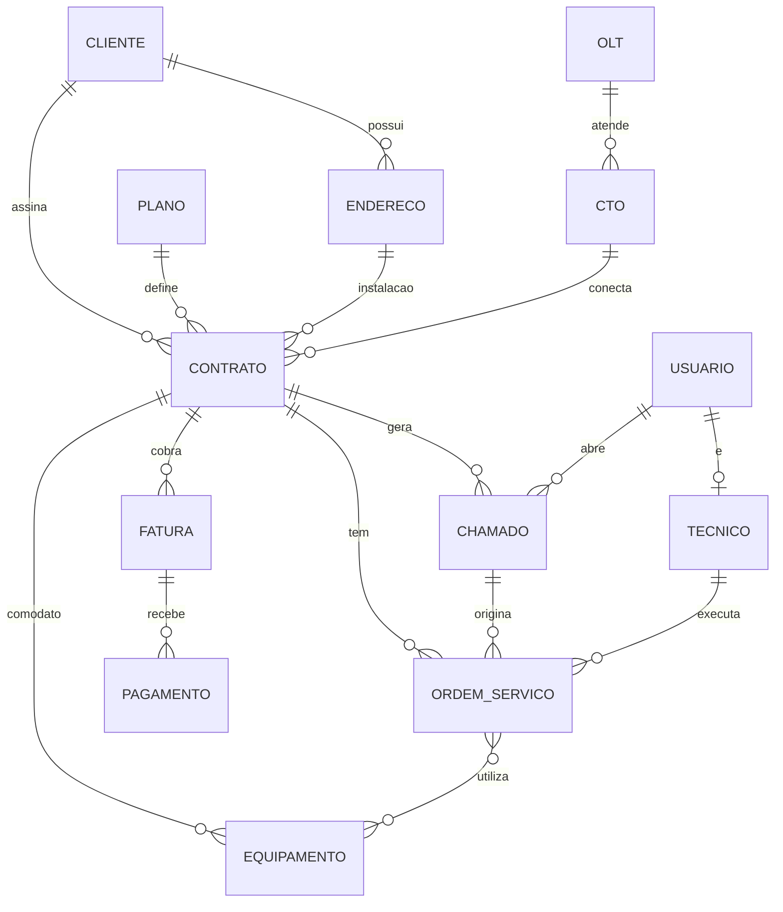

# NetGestor — Sistema de Gestão de Provedor de Internet

Projeto do **Exame de Suficiência de Tecnologia em Desenvolvimento de Sistemas (UTFPR, 2026/2)**.
Prazo de entrega: **01/11/2026**. Aluno: Igor.

## Como trabalhar neste projeto (instruções para o Claude Code)

- Responda e comente o código em **português do Brasil**.
- O projeto precisa ser **autoral**: o aluno vai explicar tudo em 3 vídeos. Por isso:
  - trabalhe **uma etapa por vez** (lista em "Etapas" abaixo) e pare ao final de cada uma;
  - ao terminar uma etapa, explique em linguagem simples **o que foi feito e por quê** (decisões técnicas);
  - prefira código **simples e didático**, sem abstrações genéricas difíceis de explicar;
  - faça **um commit git por etapa** com mensagem descritiva (o histórico mostra a evolução do projeto).
- Depois de cada mudança no backend, rode `./mvnw -q verify` (ou suba a aplicação) e corrija os erros antes de seguir.
- **Nunca** use `spring.jpa.hibernate.ddl-auto=update/create`. O schema é do **Flyway**; o JPA usa `validate`.

## Estrutura do repositório

```
netgestor/
├── backend/            # API Spring Boot
├── frontend/           # Angular
├── postman/            # coleção + environment exportados (v2.1)
├── docs/               # DER, roteiros dos vídeos
├── docker-compose.yml  # PostgreSQL
├── README.md
└── CLAUDE.md
```

## Stack

**Backend**
- Java 21, Maven (com wrapper `mvnw`)
- Spring Boot: use a versão estável oferecida pelo Spring Initializr. Se for 4.x, lembre que o Flyway usa `spring-boot-starter-flyway` e o Jackson muda para a versão 3. Confira a documentação da versão escolhida.
- Starters: Web, Data JPA, Validation, Security, HATEOAS, Flyway (+ `flyway-database-postgresql`), PostgreSQL Driver, Lombok
- JWT: `io.jsonwebtoken:jjwt-api/impl/jackson` 0.12.x, com um filtro próprio (`OncePerRequestFilter`). É mais fácil de explicar no vídeo.
- PostgreSQL 16 via Docker Compose

**Frontend**
- Angular (versão LTS/estável atual), standalone components, Bootstrap 5
- `HttpClient` + **interceptor** (envia o token e trata 401) + **guards** de rota (autenticado e por perfil)
- Serviços por recurso (`cliente.service.ts`, `contrato.service.ts`, …) e um `auth.service.ts`

**Testes de API**
- Postman (coleção v2.1 + environment), executável também via Newman

## Domínio e modelagem (13 entidades)

| # | Entidade | Atributos principais |
|---|---|---|
| 1 | **Usuario** | id, nome, email (único), senha (BCrypt), perfil (enum `ADMIN`, `ATENDENTE`, `TECNICO`), ativo |
| 2 | **Cliente** | id, nome, cpfCnpj (único), tipoPessoa (enum `FISICA`, `JURIDICA`), email, telefone, dataCadastro, ativo |
| 3 | **Endereco** | id, cep, logradouro, numero, complemento, bairro, cidade, uf, cliente (FK) |
| 4 | **Plano** | id, nome, downloadMbps, uploadMbps, valorMensal, tecnologia (enum `FIBRA`, `RADIO`), ativo |
| 5 | **Contrato** | id, numero (único), cliente (FK), plano (FK), enderecoInstalacao (FK), cto (FK, opcional), portaCto, dataInicio, diaVencimento, status (enum `ATIVO`, `SUSPENSO`, `CANCELADO`) |
| 6 | **Olt** | id, nome, ipGerencia (único), fabricante, localizacao, totalPortasPon |
| 7 | **Cto** (caixa de terminação óptica) | id, identificacao (única), olt (FK), portaPon, capacidade, latitude, longitude |
| 8 | **Equipamento** | id, tipo (enum `ONU`, `ROTEADOR`), fabricante, modelo, numeroSerie (único), mac (único), status (enum `ESTOQUE`, `INSTALADO`, `DEFEITO`), contrato (FK, opcional; comodato) |
| 9 | **Tecnico** | id, nome, telefone, especialidade, usuario (FK 1:1) |
| 10 | **Chamado** | id, protocolo (único), contrato (FK), abertoPor (Usuario FK), tipo (enum `SEM_CONEXAO`, `LENTIDAO`, `FINANCEIRO`, `OUTRO`), prioridade (enum), status (enum `ABERTO`, `EM_ATENDIMENTO`, `RESOLVIDO`, `FECHADO`), descricao, dataAbertura, dataFechamento |
| 11 | **OrdemServico** | id, numero (único), contrato (FK), chamado (FK, opcional), tecnico (FK), tipo (enum `INSTALACAO`, `REPARO`, `RETIRADA`, `MUDANCA_ENDERECO`), status (enum `AGENDADA`, `EM_EXECUCAO`, `CONCLUIDA`, `CANCELADA`), dataAgendada, dataConclusao, observacoes, equipamentos (N:N) |
| 12 | **Fatura** | id, contrato (FK), competencia (data, 1º dia do mês), valor, dataVencimento, status (enum `ABERTA`, `PAGA`, `VENCIDA`, `CANCELADA`) |
| 13 | **Pagamento** | id, fatura (FK), dataPagamento, valorPago, forma (enum `PIX`, `BOLETO`, `CARTAO`) |

### Relacionamentos (cobrem todos os tipos de mapeamento JPA)
- Cliente 1:N Endereco · Cliente 1:N Contrato
- Plano 1:N Contrato · Endereco 1:N Contrato (endereço de instalação)
- Olt 1:N Cto · Cto 1:N Contrato
- Contrato 1:N Equipamento · Contrato 1:N Chamado · Contrato 1:N OrdemServico · Contrato 1:N Fatura
- Fatura 1:N Pagamento
- Chamado 1:N OrdemServico · Tecnico 1:N OrdemServico
- Usuario 1:N Chamado (abertoPor) · **Tecnico 1:1 Usuario** (`@OneToOne`)
- **OrdemServico N:N Equipamento** (`@ManyToMany`, tabela `ordem_servico_equipamento`)



### Regras de negócio (para dar substância às rotas e aos vídeos)
- Não excluir Cliente/Plano/Olt/Cto com dependentes → **409 Conflict** com mensagem clara.
- CPF/CNPJ, e-mail, MAC e número de série duplicados → **409**.
- Contrato: `suspender` (só se ATIVO), `reativar` (só se SUSPENSO), `cancelar` (se não CANCELADO). Transição inválida → 409.
- Cto: não aceitar contrato numa porta já ocupada nem acima da capacidade.
- Chamado: `iniciar-atendimento` → `resolver` → `fechar`; ao fechar, preencher `dataFechamento`.
- Pagamento: ao registrar pagamento com valor ≥ valor da fatura, a fatura passa para PAGA.
- Equipamento vinculado a contrato passa para INSTALADO; ao desvincular, volta para ESTOQUE.

## Perfis e controle de acesso

| Perfil | Pode |
|---|---|
| ADMIN | tudo, incluindo CRUD de Usuario, Plano, Olt, Cto |
| ATENDENTE | Clientes, Enderecos, Contratos, Chamados, Faturas, Pagamentos; leitura de Planos |
| TECNICO | leitura de Contratos/Cto/Olt; Equipamentos; Ordens de Serviço (ver e atualizar status) |

Use `@EnableMethodSecurity` + `@PreAuthorize`. Sem token → **401**; perfil sem permissão → **403**. Os dois devem retornar JSON padronizado (configure `AuthenticationEntryPoint` e `AccessDeniedHandler`).

## API: convenções (Modelo de Maturidade de Richardson)

- **Nível 1, recursos:** URIs no plural sob `/api`: `/api/clientes`, `/api/clientes/{id}`, sub-recursos como `/api/clientes/{id}/enderecos`, `/api/faturas/{id}/pagamentos`.
- **Nível 2, verbos e status:**
  - `GET` lista → 200 · `GET /{id}` → 200 / 404
  - `POST` → **201 Created** + header `Location` + corpo
  - `PUT /{id}` → 200 · `PATCH /{id}/acao` → 200
  - `DELETE /{id}` → **204 No Content**
  - validação → **400** com lista de erros por campo · conflito de regra → **409**
- **Nível 3, HATEOAS:** respostas em HAL (`application/hal+json`):
  - um `RepresentationModelAssembler` por recurso, retornando `EntityModel`/`CollectionModel`;
  - links `self`, coleção e recursos relacionados (ex.: contrato → `cliente`, `plano`, `faturas`, `chamados`);
  - **links condicionais por estado** (principal evidência do nível 3): contrato ATIVO expõe `suspender` e `cancelar`; SUSPENSO expõe `reativar`; chamado ABERTO expõe `iniciar-atendimento`, etc. O frontend usa esses links para decidir quais botões mostrar;
  - use `@Relation(collectionRelation = "clientes")` nos DTOs para o `_embedded` ter nomes limpos.
- DTOs com `record` (Request e Response separados) e Bean Validation. Entidades nunca saem direto no controller.
- Erros: um `@RestControllerAdvice` com formato único `{timestamp, status, erro, mensagem, caminho, campos[]}`.
- Consultas específicas (Spring Data, métodos derivados e/ou `@Query` JPQL), por exemplo:
  - `GET /api/clientes?nome=&cpfCnpj=`
  - `GET /api/contratos?status=ATIVO&clienteId=`
  - `GET /api/chamados?status=&prioridade=`
  - `GET /api/faturas?status=VENCIDA&competencia=2026-10`
  - `GET /api/tecnicos/{id}/ordens-servico?status=`
  - `GET /api/ctos/{id}/ocupacao` (portas usadas/livres)
  - `GET /api/auth/me`
- CORS liberado para `http://localhost:4200`.

## Pacotes do backend (arquitetura em camadas)

```
br.edu.utfpr.netgestor
├── config/        # CORS, beans gerais
├── security/      # SecurityConfig, JwtService, JwtAuthFilter, handlers 401/403, UserDetailsService
├── domain/        # entidades e enums
├── repository/    # interfaces Spring Data JPA
├── service/       # regras de negócio, @Transactional
├── controller/    # REST controllers
├── dto/           # records de request/response
├── assembler/     # RepresentationModelAssemblers (HATEOAS)
└── exception/     # exceções de negócio + @RestControllerAdvice
```

## Flyway (`backend/src/main/resources/db/migration`)

- `V1__criar_tabelas.sql`: todas as tabelas, PKs (`BIGSERIAL`), FKs, `UNIQUE`, `NOT NULL`, `CHECK` para enums e valores positivos
- `V2__dados_iniciais.sql`: usuários dos 3 perfis (hash **BCrypt válido**, gerado com o `PasswordEncoder` do projeto, nunca inventado), planos, OLT/CTOs, clientes, contratos, equipamentos, chamados, OS e faturas suficientes para testar
- `V3__...`: uma evolução real do banco feita durante o desenvolvimento (ex.: `ip_fixo` em contrato, ou `sla_horas` em chamado)

Usuários iniciais (documentar no README):
- `admin@netgestor.com` / `admin123`
- `atendente@netgestor.com` / `atendente123`
- `tecnico@netgestor.com` / `tecnico123`

Configuração por variáveis de ambiente com valores padrão para desenvolvimento (`DB_URL`, `DB_USER`, `DB_PASSWORD`, `JWT_SECRET`, `JWT_EXPIRATION`).

## Frontend (Angular): escopo mínimo

- Login → guarda o token (localStorage) → interceptor envia `Authorization: Bearer`; 401 → logout e redireciona para o login
- Layout com menu de acordo com o perfil do usuário logado
- CRUD completo: **Clientes** (com endereços), **Planos**, **Contratos**
- **Contratos:** botões suspender/reativar/cancelar exibidos conforme os `_links` da API (HATEOAS no front)
- **Chamados:** abrir, listar com filtro, mudar status
- **Ordens de Serviço:** listar e atualizar status (visão do técnico)
- Mensagens de sucesso/erro (toasts) usando a `mensagem` retornada pela API; erros de validação exibidos nos campos
- Pastas: `core/` (auth, interceptor, guards, models), `features/<recurso>/` (páginas + service), `shared/` (componentes reutilizáveis)

## Postman (`postman/`)

- `NetGestor.postman_collection.json` + `NetGestor.postman_environment.json` (`baseUrl`, `token`, ids)
- Pasta `00 - Autenticação`: login de cada perfil (script salva `token`), login inválido (401), `/auth/me`
- Uma pasta por recurso: Cadastrar (salva id no environment), Listar, Buscar por ID, Atualizar, Excluir, consultas específicas
- Testes negativos: sem token (401), perfil sem permissão (403), validação (400), não encontrado (404), conflito (409)
- Pasta `99 - Fluxos`: fluxo completo (cliente → contrato → chamado → OS → fatura → pagamento)
- Cada request com `pm.test` validando status e campos/links principais
- Autorização Bearer `{{token}}` herdada no nível da coleção
- Verificar com `npx newman run postman/NetGestor.postman_collection.json -e postman/NetGestor.postman_environment.json`

## Etapas (uma por vez, com commit ao final)

1. Setup: docker-compose, projeto Spring, `application.yml`, estrutura de pacotes, app subindo
2. Flyway V1 + V2 e entidades + repositories (`ddl-auto=validate` passando)
3. DTOs, services, controllers, tratamento de erros (CRUD de todas as entidades)
4. HATEOAS: assemblers, links condicionais e endpoints de ações/consultas
5. Segurança JWT: login, filtro, perfis, 401/403 em JSON
6. Coleção do Postman + execução com Newman sem falhas
7. Frontend Angular
8. V3 do Flyway (evolução) + README completo + `docs/` (DER, roteiros dos vídeos)

## README.md (itens obrigatórios do enunciado)

Nome, descrição, tecnologias, como executar o backend e o frontend, configuração do banco, integração front ↔ API, usuários/senhas iniciais, autenticação e uso do JWT, explicação do Modelo de Richardson com exemplos de resposta, **referências** (materiais da disciplina, documentação oficial) e **declaração de uso de ferramentas de IA** como apoio ao desenvolvimento (o enunciado exige citar o material de apoio).
