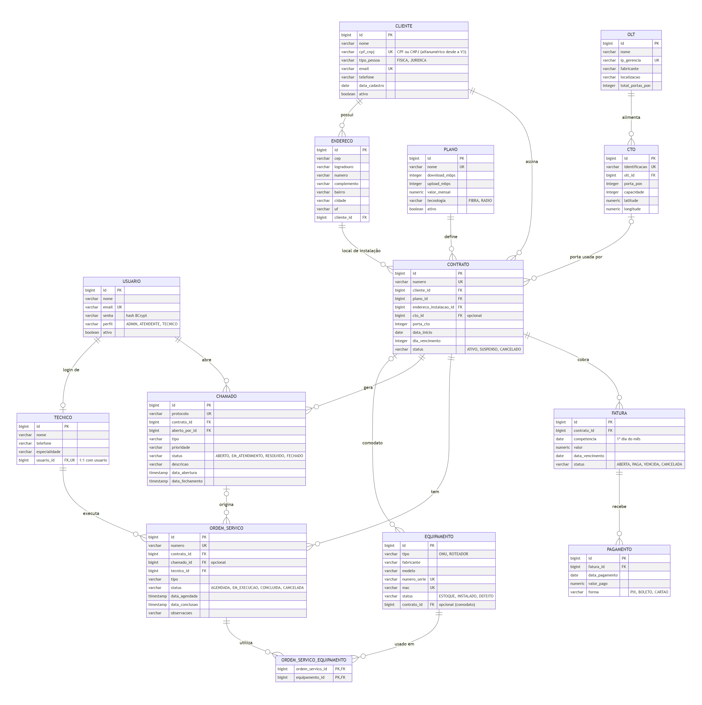
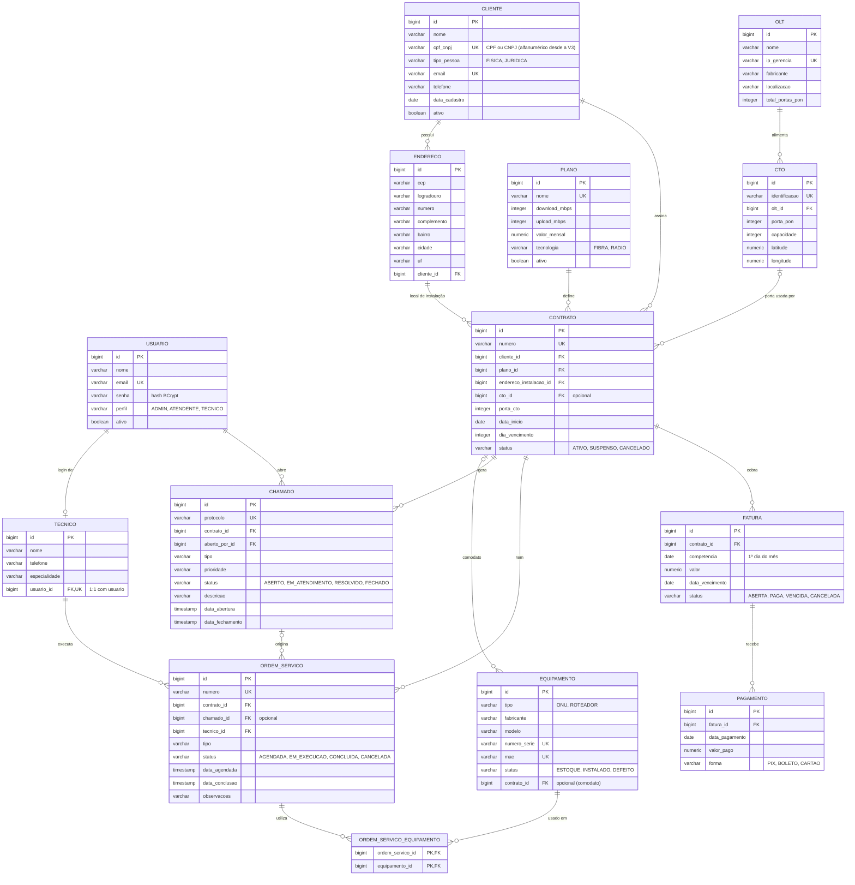

# DER - Diagrama Entidade-Relacionamento

Modelo físico do banco do NetGestor (PostgreSQL 16), criado e evoluído pelas migrations do Flyway
(`backend/src/main/resources/db/migration`). São **13 entidades** e uma tabela de junção para o relacionamento N:N.

Código Mermaid do diagrama (renderizado automaticamente no GitHub)

## Relacionamentos e mapeamento JPA

| Relacionamento | Tipo | Mapeamento JPA |
|---|---|---|
| Cliente → Endereços | 1:N | `@OneToMany(mappedBy = "cliente", cascade = ALL, orphanRemoval = true)` em `Cliente`; `@ManyToOne` em `Endereco` |
| Cliente / Plano / Endereço / CTO → Contrato | 1:N | `@ManyToOne(fetch = LAZY)` em `Contrato` (CTO opcional) |
| OLT → CTOs | 1:N | `@OneToMany(mappedBy = "olt")` em `Olt`; `@ManyToOne` em `Cto` |
| Contrato → Equipamentos, Chamados, OS, Faturas | 1:N | `@ManyToOne` no lado filho |
| Fatura → Pagamentos | 1:N | `@OneToMany(mappedBy = "fatura")` em `Fatura`; `@ManyToOne` em `Pagamento` |
| Chamado → OS / Técnico → OS / Usuário → Chamado | 1:N | `@ManyToOne` no lado filho (chamado da OS é opcional) |
| **Técnico ↔ Usuário** | **1:1** | `@OneToOne` + `usuario_id UNIQUE` no banco |
| **Ordem de serviço ↔ Equipamento** | **N:N** | `@ManyToMany` + `@JoinTable(name = "ordem_servico_equipamento")` |

## Restrições importantes (garantidas pelo próprio banco)

- `UNIQUE`: e-mail de usuário e de cliente, CPF/CNPJ, nome do plano, IP da OLT, identificação da CTO,
  número do contrato, número de série e MAC do equipamento, protocolo do chamado, número da OS,
  fatura por contrato + competência (`uk_fatura_contrato_competencia`).
- **Índice único parcial** `uk_contrato_cto_porta_em_uso (cto_id, porta_cto) WHERE status <> 'CANCELADO'`:
  uma porta da CTO só pode ter um contrato que não esteja cancelado.
- `CHECK` dos enums (valores permitidos) e de valores positivos (velocidades, preços, capacidade).
- `CHECK` de consistência: pessoa física → CPF de 11 dígitos, jurídica → CNPJ; CTO e porta informadas juntas;
  equipamento `INSTALADO` se e somente se tiver contrato; chamado `FECHADO` exige `data_fechamento`;
  OS `CONCLUIDA` exige `data_conclusao`; competência sempre no 1º dia do mês.

## Migrations (versionamento do banco)

| Versão | Arquivo | O que faz |
|---|---|---|
| V1 | `V1__criar_tabelas.sql` | Cria as 14 tabelas, PKs, FKs, UNIQUEs, CHECKs e índices |
| V2 | `V2__dados_iniciais.sql` | Dados de teste: usuários dos 3 perfis (senhas com BCrypt), planos, rede, clientes, contratos, equipamentos, chamados, OS, faturas e pagamentos |
| V3 | `V3__cnpj_alfanumerico.sql` | Evolução: aceita o CNPJ alfanumérico da Receita Federal (12 caracteres 0-9/A-Z + 2 dígitos verificadores) e cadastra um cliente de exemplo |
